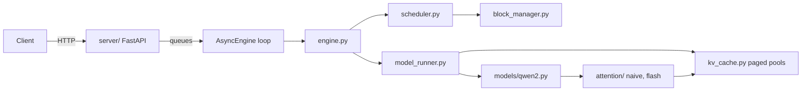

# minivllm

An LLM inference engine written from scratch to implement and measure the techniques
behind vLLM: continuous batching, a paged KV cache, prefix caching, chunked prefill and
CUDA graphs. It runs Qwen2 models from HF safetensors, serves an OpenAI compatible API,
and has benchmark scripts that compare it with vLLM on the same GPU. No benchmark has
been run yet; see the benchmark section.

## Architecture



The scheduler decides what runs and only talks to the block manager. The model runner
turns that decision into tensors and runs the model. The engine can be used as a library
without the server.

## Quickstart

```bash
pip install -e ".[server,test,bench]"
python -m minivllm.generate --prompt "The capital of France is" --max-tokens 32
python -m minivllm.server --model Qwen/Qwen2.5-0.5B-Instruct
python -m pytest
```

Every setting is a flag of `EngineConfig`; `python -m minivllm.server --help` lists them.
Defaults run on CPU in float32. GPU runs need `--device cuda` and, for the fast path,
`--attention-backend flash` with the `flash-attn` package installed.

## Supported features

- Qwen2 architecture (Qwen2.5 0.5B and 1.5B Instruct), written by hand; no transformers
  model classes at runtime
- Llama architecture without rope scaling (the same code with no attention bias). Tested
  against a tiny random-weight HF Llama only; no real Llama checkpoint has been run, and
  Llama 3 checkpoints, which use rope scaling, are rejected with an error
- Greedy, temperature and top-p sampling
- Static batching baseline (`--scheduler static`)
- Continuous batching with a paged KV cache (`--block-size`, `--kv-budget-gb`),
  preemption by recompute
- Prefix caching (`--enable-prefix-caching`)
- Chunked prefill (`--enable-chunked-prefill`)
- Attention backends: `naive` (gather and SDPA, the reference) and `flash`
  (`flash_attn_with_kvcache`, CUDA only, not yet run)
- CUDA graph replay for decode (`--enable-cuda-graphs`, not yet run)
- OpenAI compatible server: `/v1/completions`, `/v1/chat/completions` with SSE
  streaming, `/v1/models`, `/health`, `/metrics`

Not supported: other architectures, rope scaling, tensor parallelism, quantization, speculative
decoding, logprobs, `n > 1`, stop strings.

## Tests

Greedy outputs match HF transformers token for token on 20 prompts, on CPU in float32,
for static batches of 1, 4 and 16, continuous batching, and chunked prefill. The block
manager and scheduler have randomized tests that check no blocks leak. GPU only tests
are marked `gpu` and skipped without a GPU.

## Benchmarks

Tables and charts here are generated from `bench/results` by `bench/make_tables.py` and
`bench/make_charts.py`. Run `bench/run_all.sh` on a GPU machine to produce them.

<!-- BENCH:START -->

No benchmark results have been generated yet.

<!-- BENCH:END -->

Design decisions and their alternatives are in [DESIGN_NOTES.md](DESIGN_NOTES.md).
What was built, what was verified, and what is still open is in [REPORT.md](REPORT.md).

## Why I built this

I wanted to understand LLM serving by building it, not by reading about it. The ideas
behind vLLM are easy to summarize: batch requests continuously, store the KV cache in
fixed-size blocks, reuse blocks when prompts share a prefix. They are much harder to get
right. The bugs live in the details: a block freed while another sequence still reads it,
a preempted request that resumes with different output, a half-prefilled prompt that
stalls every decode behind it.

So I wrote each piece myself, one phase at a time, and gave every phase a test that had to
pass before the next one started. The test that matters most compares every generated
token with Hugging Face transformers. If a scheduler change, a block reuse or a chunk
boundary alters a single token, it fails. That test caught the mistakes I would not have
spotted by reading the code.

What came out is a small engine I can explain line by line: a scheduler, a block manager
with reference counts and an LRU pool, a model runner, an attention interface with a
reference backend, and an OpenAI compatible server. `DESIGN_NOTES.md` records why each
choice was made and what I rejected.

What this repository does not have yet is measurements. The benchmark scripts compare
against vLLM on the same GPU, model and client, but I have not run them, and I will not
quote a number until the raw results are committed. I would rather show an honest gap than
an estimate.
