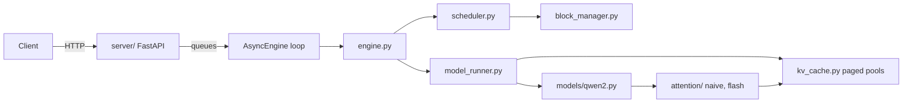

# minivllm

An LLM inference engine written from scratch to implement and measure the techniques
behind vLLM: continuous batching, a paged KV cache, prefix caching, chunked prefill and
CUDA graphs. It runs Qwen2 models from HF safetensors, serves an OpenAI compatible API,
and has benchmark scripts that compare it with vLLM on the same GPU. No benchmark has
been run yet; see the benchmark section.

## Architecture



The scheduler decides what runs and only talks to the block manager. The model runner
turns that decision into tensors and runs the model. The engine can be used as a library
without the server.

## Quickstart

```bash
pip install -e ".[server,test,bench]"
python -m minivllm.generate --prompt "The capital of France is" --max-tokens 32
python -m minivllm.server --model Qwen/Qwen2.5-0.5B-Instruct
python -m pytest
```

Every setting is a flag of `EngineConfig`; `python -m minivllm.server --help` lists them.
Defaults run on CPU in float32. GPU runs need `--device cuda` and, for the fast path,
`--attention-backend flash` with the `flash-attn` package installed.

## Supported features

- Qwen2 architecture (Qwen2.5 0.5B and 1.5B Instruct), written by hand; no transformers
  model classes at runtime
- Greedy, temperature and top-p sampling
- Static batching baseline (`--scheduler static`)
- Continuous batching with a paged KV cache (`--block-size`, `--kv-budget-gb`),
  preemption by recompute
- Prefix caching (`--enable-prefix-caching`)
- Chunked prefill (`--enable-chunked-prefill`)
- Attention backends: `naive` (gather and SDPA, the reference) and `flash`
  (`flash_attn_with_kvcache`, CUDA only, not yet run)
- CUDA graph replay for decode (`--enable-cuda-graphs`, not yet run)
- OpenAI compatible server: `/v1/completions`, `/v1/chat/completions` with SSE
  streaming, `/v1/models`, `/health`, `/metrics`

Not supported: models other than Qwen2, tensor parallelism, quantization, speculative
decoding, logprobs, `n > 1`, stop strings.

## Tests

Greedy outputs match HF transformers token for token on 20 prompts, on CPU in float32,
for static batches of 1, 4 and 16, continuous batching, and chunked prefill. The block
manager and scheduler have randomized tests that check no blocks leak. GPU only tests
are marked `gpu` and skipped without a GPU.

## Benchmarks

Tables and charts here are generated from `bench/results` by `bench/make_tables.py` and
`bench/make_charts.py`. Run `bench/run_all.sh` on a GPU machine to produce them.

<!-- BENCH:START -->

No benchmark results have been generated yet.

<!-- BENCH:END -->

Design decisions and their alternatives are in [DESIGN_NOTES.md](DESIGN_NOTES.md).
What was built, what was verified, and what is still open is in [REPORT.md](REPORT.md).

## Why I built this

